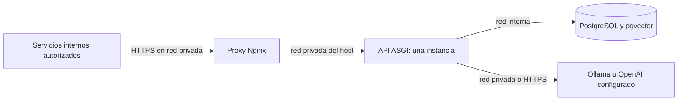

# Diseño de despliegue compartido para RAG

**Estado: adaptación y proxy de laboratorio implementados; despliegue compartido no implementado.** `rag.api` conserva el servidor local y `rag.asgi` añade un adaptador experimental. El entorno de `tests/proxy_fixture` usa certificados y credenciales temporales de prueba, un proveedor simulado y un puerto publicado solo en localhost. Las medidas para una red compartida descritas aquí aún no están configuradas ni verificadas.

## Caso de uso y límites

Un equipo pequeño en una red privada necesita que dos servicios internos accedan a un único corpus: uno indexa documentos y otro hace consultas. La propuesta cubre **una instancia en un solo host**, no internet pública, alta disponibilidad, múltiples organizaciones ni autorización por documento. Todos los lectores autorizados pueden recibir cualquier fragmento del corpus. El operador controla la red y el host; el tráfico entre procesos en ese mismo host se considera dentro de ese límite de confianza. Si cualquiera de esas suposiciones cambia, hay que rediseñar la identidad, el aislamiento y el transporte interno.

## Componentes y decisión

- **Nginx** termina TLS y aplica límites de tamaño, tasa y conexiones antes de transmitir a la aplicación. Solo su puerto HTTPS se publica en la interfaz privada del host, con reglas de red que admitan únicamente clientes autorizados. Nginx no reemplaza la autenticación de la aplicación.
- **API ASGI con Uvicorn**, detrás del proxy, con una única instancia y un solo proceso inicialmente. La API local hereda de `BaseHTTPRequestHandler` y no es ASGI por sí misma. El adaptador `rag.asgi` reutiliza sus validaciones y operaciones mediante un adaptador de peticiones; es una solución de transición, no una extracción completa de la capa HTTP. La prueba aislada usa Uvicorn con un proceso. La [documentación de Uvicorn](https://github.com/encode/uvicorn/blob/master/docs/settings.md) describe las opciones de ejecución y procesos.
- **PostgreSQL/pgvector** sin puerto publicado hacia clientes. La creación de extensión y tablas es un paso administrativo separado. La cuenta de ejecución recibe únicamente los permisos necesarios sobre las tablas; no instala extensiones ni crea esquemas. Datos en un volumen persistente, con copias y recuperación verificadas.
- **Modelo:** inicialmente Ollama dentro de la misma red privada y sin puerto publicado a la red de clientes. Si se usa un proveedor remoto, solo la API recibe salida HTTPS hacia el destino configurado. No enviar los datos a otro proveedor de forma implícita. El acceso a internet, DNS y las reglas de salida deben ser explícitos; una red Docker marcada `internal` por sí sola no sirve como salida a OpenAI.

La migración puede mantener funciones síncronas de embeddings y PostgreSQL al principio, pero debe ejecutarlas en un conjunto **acotado de hilos de trabajo** para no bloquear el bucle ASGI. El número de hilos, las conexiones disponibles y la concurrencia del modelo deben dimensionarse conjuntamente. Rechazar nuevas peticiones cuando no haya capacidad; no crear una cola ilimitada. Un límite por proceso se multiplica al añadir procesos o réplicas, por lo que escalar exige volver a definir el límite global.

## TLS, red y secretos

1. El proxy presenta un certificado para el nombre interno del servicio, emitido por una autoridad que los clientes confíen. Los clientes validan nombre y cadena. El operador provisiona y renueva certificado y clave fuera del repositorio y verifica la recarga antes del vencimiento. Eliminar soporte de HTTP en la interfaz compartida; no aceptar certificados autofirmados sin configurar confianza explícita.
2. Solo el proxy puede alcanzar el puerto de aplicación y solo la aplicación puede alcanzar la base y el modelo. La comunicación proxy–API se limita a una red privada del mismo host; no se afirma que esté cifrada. Si cruza hosts o redes no confiables, añadir TLS autenticado entre servicios y volver a evaluar el modelo de amenazas. PostgreSQL y Ollama no se publican al host ni a clientes.
3. Mantener credenciales separadas de lectura y escritura, comparar de forma resistente a variaciones de tiempo y no registrar el encabezado `Authorization`. El prefijo `api:` organiza documentos, pero no es autorización ni separación entre inquilinos. Aplicar restricciones de acceso de red además de los tokens.
4. Provisionar secretos con un mecanismo del entorno y permisos restringidos; no incorporarlos en la imagen, archivos versionados, URLs, ejemplos ni registros. Las variables de entorno actuales son cómodas para desarrollo pero pueden quedar expuestas a administradores del host y mediante inspección del entorno; evaluar archivos montados o un gestor de secretos y adaptar la aplicación antes del despliegue. Definir rotación y revocación sin confiar en credenciales impresas en consola.
5. El proxy elimina o reemplaza los encabezados de identidad y dirección suministrados por clientes. Solo confiar en cabeceras reenviadas de proxies explícitamente autorizados; para un único proxy, evitar permitir direcciones arbitrarias. Nunca utilizar un encabezado de cliente sin verificar para autorizar o aplicar límites.

## Límites y plazos: hipótesis para pruebas

Los valores siguientes son **puntos de partida de laboratorio**, no objetivos de capacidad garantizados. Deben revisarse después de medir el modelo y la memoria del host.

| Capa | Propuesta inicial | Motivo y límite |
| --- | --- | --- |
| Proxy: tamaño | Documento hasta 1.000.000 bytes; JSON hasta 32.000 bytes, por ruta | Mantener los límites actuales y comprobarlos de nuevo en la aplicación. Decidir cómo devolver un error consistente si el proxy rechaza antes de llegar a la API. |
| Proxy: tasa | Comenzar en 6 solicitudes/minuto por IP, ráfaga de 2; emitir 429 y `Retry-After` configurado | Es una hipótesis conservadora para medición, no una cuota por usuario. Clientes detrás del mismo NAT comparten el límite; múltiples IP pueden eludirlo. El módulo [`limit_req`](https://nginx.org/en/docs/http/ngx_http_limit_req_module.html) limita por clave y su código por defecto es 503, por lo que hay que configurarlo explícitamente. |
| Proxy: concurrencia | Hasta 2 solicitudes activas por IP y 4 globales | Rechazo controlado al exceder el límite. [`limit_conn`](https://nginx.org/en/docs/http/ngx_http_limit_conn_module.html) cuenta solicitudes después de leer las cabeceras; no protege por sí solo contra todos los clientes lentos. |
| API: capacidad | Máximo 4 operaciones de modelo en curso en la única instancia; sin cola de espera ilimitada | Un semáforo compartido dentro del proceso se mantiene adquirido hasta que termine realmente el trabajo, incluso si el cliente desconecta. No supone un límite global válido con varios procesos o réplicas. |
| Transporte | Tiempo de recepción de cabeceras y cuerpo, conexión a proveedor y base acotados; parámetros concretos pendientes de pruebas | Los tiempos de lectura entre operaciones del proxy no son un plazo total de solicitud. [`proxy_read_timeout`](https://nginx.org/en/docs/http/ngx_http_proxy_module.html#proxy_read_timeout) se aplica entre lecturas sucesivas. |

La API actual usa hasta 120 segundos por llamada al proveedor y 10 segundos para conectar a PostgreSQL. Una consulta puede ejecutar dos llamadas al proveedor; por tanto, un timeout del proxy de 120 segundos podría cortar solicitudes válidas. Antes del despliegue hay que fijar y probar un **presupuesto total por operación**, más corto que el tiempo de espera del cliente y compatible con el proxy, además de límites individuales para conexión, lectura y base de datos. Un timeout de red no garantiza que el trabajo remoto o un hilo síncrono se haya cancelado: la capacidad debe seguir ocupada hasta que realmente finalice. En una indexación cortada cerca del commit, el resultado puede ser incierto; el cliente puede repetir el mismo `PUT`, asumiendo que recalcular embeddings tiene coste. No reintentar automáticamente generación ni escrituras desde el proxy.

La aplicación actual tiene un timeout de socket de 30 segundos para lectura, pero eso no es un plazo global contra clientes que transmiten lentamente. El proxy necesita límites de cabeceras y lectura de cuerpo, así como protección adicional de red según el entorno. La API y el proxy no deben devolver excepciones, consultas SQL ni respuestas completas de proveedores a los clientes.

## Operación y observabilidad

- La aplicación genera el identificador de solicitud y registra etapas, duración, estado y proveedor, sin preguntas, fragmentos, rutas, tokens ni cuerpos. El proxy registra solo campos necesarios y evita URL con parámetros, autorización y cuerpos. Evitar el registro de acceso predeterminado si incluye campos sensibles y probar las salidas reales. La correlación para rechazos anteriores a la aplicación requiere un identificador generado por el proxy; definir su validación y propagación antes de implementarla.
- Exponer comprobaciones separadas: **vida** del proceso, sin llamar al modelo, y **disponibilidad** de dependencias, accesible únicamente desde la red de administración. Una prueba de disponibilidad no debe generar embeddings facturables ni filtrar información sensible. Definir cómo manejar el estado del modelo local sin convertir un fallo temporal en reinicios continuos.
- Medir solicitudes, rechazos, errores por clase, peticiones activas y duración por etapa. No inferir consumo de tokens si el proveedor no lo reporta. Definir retención y control de acceso a registros y métricas. No almacenar respuestas ni entradas de clientes para diagnóstico por defecto.
- Ante fallos de proveedor o base, responder con códigos estables y mensajes genéricos; evitar reintentos internos automáticos que dupliquen coste o sobrecarga. Mantener explícitos los códigos actuales y comprobar también los errores producidos por el proxy.
- Contenedores con usuario sin privilegios, versiones fijadas y configuración mínima. Comprobar la política de actualización, escaneo, copias, restauración y permisos antes de usar datos reales. La imagen existente solo arranca el CLI y la API actual escucha en loopback: se requiere trabajo explícito de empaquetado y red, no basta con publicar un puerto.

## Plan de pruebas de carga y fallos

Ejecutar primero en un entorno aislado con base y corpus sintéticos. Usar un proveedor simulado y controlable, sin claves reales ni llamadas facturables, capaz de responder correctamente, esperar, cerrar la conexión y devolver errores. No inyectar fallos en los servicios de usuario.

1. **Contrato y protección:** validar TLS con CA y nombre correctos e incorrectos; permisos de lectura/escritura; tamaños límite y límite + 1; headers duplicados, contenido inválido y ausencia de secretos en respuestas y registros. Confirmar que no se puede acceder directamente a aplicación, PostgreSQL ni Ollama desde la red cliente.
2. **Capacidad con carga sostenida:** establecer primero una línea base con un cliente. Aumentar gradualmente la concurrencia de 1 a 2, 4 y por encima de 4, tanto para lectura como indexación, durante intervalos definidos por el operador. Registrar tasa ofrecida y completada, p50/p95/p99 de duración de extremo a extremo y por etapa, estado HTTP, conexiones cortadas, CPU, memoria y número máximo de trabajos reales de modelo. No interpretar los tiempos de un proveedor simulado como capacidad de un modelo real.
3. **Sobrecarga y recuperación:** sostener carga por encima del límite, comprobar que se devuelven rechazos controlados, que los trabajos activos no exceden el límite y que el servicio vuelve a la línea base al reducir la carga. Comprobar NAT compartido y cabeceras falsificadas, y observar 429/503 y `Retry-After` tal como se especifiquen.
4. **Dependencias y escrituras:** detener o ralentizar la base y el proveedor simulado, probar timeouts, desconexión del cliente y recuperación. Verificar que una escritura fallida antes de confirmar conserva la versión anterior y que nunca se mezclan fragmentos de dos versiones. Probar expresamente el resultado incierto al perder la respuesta cerca del commit, sin asumir que el trabajo fue cancelado.
5. **Prueba con modelo real:** solo después de las pruebas simuladas, ejecutar una prueba corta y de baja concurrencia con Ollama y datos sintéticos; medir la distribución real y memoria sin extrapolar desde una única máquina. Si se propone OpenAI, revisar antes la autorización, datos enviados y coste. No ejecutar carga contra proveedores externos por defecto.

Las pruebas deterministas de contrato, autorización y fallos simulados deben integrarse en CI con una base temporal; las pruebas de carga y con modelos reales deben ser optativas y ejecutarse en infraestructura aislada. Registrar configuración, versiones, hardware, datos, duración y resultados para repetirlas. No se han ejecutado estas pruebas ni se ha definido todavía un SLO numérico.

## Condiciones para implementar y evaluar la puesta en marcha

1. Acordar el entorno privado, responsable de certificados/secretos y tolerancias de latencia y disponibilidad; sin esos datos no puede afirmarse que los valores de ejemplo sean adecuados.
2. Implementar la capa ASGI y el proxy en una rama de trabajo, preservando el contrato y los límites de datos; probar diferencias de protocolo, timeouts, identidad y cierre de conexiones.
3. Preparar configuración y automatización reproducibles, gestión de secretos y base de datos con permisos mínimos. Revisar que ningún puerto o secreto se publique por accidente.
4. Ejecutar las pruebas anteriores, documentar resultados y ajustar límites basándose en mediciones. Mantener desactivada la publicación compartida hasta completar esta verificación y acordar el entorno de despliegue.
