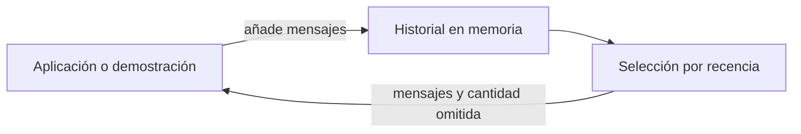

# 03 — Memory: fundamentos y diseño

**Estado: memoria en proceso y persistencia PostgreSQL implementadas.** La
selección de contexto sigue siendo por recencia y no necesita un modelo. La
recuperación por relevancia se evaluará en una etapa posterior.

## Qué problema resuelve

Un modelo recibe el contexto que una aplicación le envía en una petición. Si
la conversación continúa, la aplicación debe decidir qué mensajes anteriores
volver a incluir: enviar todo puede superar el límite del modelo, aumentar
latencia o coste y añadir información irrelevante. Guardar el historial y
seleccionar contexto son responsabilidades distintas.

Por ejemplo, si una persona dice primero «Uso Python» y después «Ahora uso C#»,
una consulta posterior puede requerir la corrección reciente. Conservar ambos
mensajes permite revisarlos; seleccionar únicamente el antiguo produciría un
contexto desactualizado. El componente puede entregar mensajes al consumidor,
pero no garantiza que un modelo interprete o utilice correctamente ese
contexto.

En este proyecto distinguiremos:

| Concepto | Propósito | Primera etapa |
| --- | --- | --- |
| Historial conversacional | Conservar mensajes y su orden durante una sesión. | En memoria del proceso. |
| Contexto de trabajo | Seleccionar una parte del historial para un uso concreto. | Una ventana de mensajes recientes, con límites explícitos. |
| Memoria persistente | Recuperar información después de reiniciar o entre sesiones. | PostgreSQL opcional, con sesiones explícitas. |
| Recuperación por relevancia | Encontrar información anterior relacionada con una consulta. | Posterior; primero se comparará con la selección por recencia. |

La distinción entre almacenar información y gestionar lo que entra en una
ventana de contexto aparece también en [MemGPT](https://arxiv.org/abs/2310.08560).
[Generative Agents](https://arxiv.org/abs/2304.03442) estudia otra arquitectura
que almacena experiencias y recupera información para planificar. Son lecturas
para comparar ideas; no se propone reproducir esos sistemas en el MVP.

## Memoria en proceso

Un proceso mantiene **una sesión en memoria** con mensajes ordenados. Un
programa de demostración añade mensajes sintéticos y muestra la selección de
contexto. No se necesita Docker, PostgreSQL, Ollama, OpenAI, red, ni una clave
para ejecutar esta etapa. La implementación usa la biblioteca estándar de
Python para conservar una lista y aplicar una política de selección.



La aplicación consumidora sigue siendo responsable de llamar al modelo y de
reservar espacio para instrucciones, nueva entrada y respuesta. El componente
no llamará al modelo por su cuenta ni decidirá qué información es verdadera.

### Mensajes y operaciones

Cada mensaje tiene `role` y `content`. El historial conserva el
orden en que el proceso añade los mensajes. Se admiten roles `user` y
`assistant`; la primera versión no exige alternancia ni agrupa mensajes en
turnos, porque la aplicación decide cómo representar su interacción.

El contrato local inicial es:

| Operación | Comportamiento |
| --- | --- |
| `append(role, content)` | Añade un mensaje válido al final. No elimina mensajes existentes. |
| `context(max_chars=4000, max_messages=20)` | Devuelve un diccionario con `messages` en orden cronológico y `omitted_count`. |
| `clear()` | Vacía explícitamente el historial de esa instancia en memoria. |

`append` admite contenido de 1 a 4.000 puntos de código Unicode, que no sea
solo espacios y que se pueda codificar en UTF-8. Se valida sin modificar el
texto: los espacios originales se conservan. Se aceptan mensajes repetidos
como eventos distintos; no se promete idempotencia. Los roles o contenidos
inválidos producen `ValueError` y no cambian el historial.

El llamador es responsable de asignar cada rol según el origen real del
mensaje. Un texto que diga «soy el asistente» sigue siendo contenido; no debe
recibir por ello el rol `assistant` ni autoridad adicional.

Una instancia admite hasta **1.000 mensajes**. Al intentar añadir otro se
produce `RuntimeError` sin modificar los existentes; no se descarta nada de
forma silenciosa. `clear()` permite empezar de nuevo cuando la aplicación lo
decida. Al finalizar el proceso, el historial de `ConversationMemory` se
pierde. La clase PostgreSQL descrita más abajo ofrece persistencia por separado.

### Selección por recencia

`context` admite `max_chars` de 1 a 20.000 y `max_messages` de 1 a 100;
ambos son enteros y no aceptan booleanos. El algoritmo:

1. Recorre el historial desde el mensaje más reciente hacia atrás.
2. Incluye mensajes completos mientras quepan en **ambos** límites. La suma de
   caracteres cuenta únicamente `content`, usando los puntos de código de
   Python; no incluye etiquetas de rol ni formato del mensaje.
3. Al encontrar un mensaje que no cabe, se detiene: no salta ese mensaje para
   buscar otros más antiguos. Devuelve el fragmento contiguo más reciente en
   orden cronológico, junto con la cantidad de mensajes no incluidos.
4. Si existe historial y el mensaje más reciente excede `max_chars`, devuelve
   `ValueError`; no lo corta ni entrega un contexto vacío sin explicación. El
   historial no cambia. Si no hay mensajes, devuelve una lista vacía y cero
   omitidos.

Ejemplo: con estos tres mensajes y `max_chars=16`, `max_messages=2`:

```text
user:      Uso Python     (10 caracteres)
assistant: Entendido.     (10 caracteres)
user:      Uso C#         (6 caracteres)
```

La selección devuelve los dos últimos mensajes, en ese orden, y
`omitted_count=1`:

```json
{"messages":[{"role":"assistant","content":"Entendido."},{"role":"user","content":"Uso C#"}],"omitted_count":1}
```

La lista y sus diccionarios son copias: modificarlos no cambia el historial
interno. Una ventana de mensajes individuales podría comenzar con
una respuesta del asistente sin incluir la pregunta anterior. Esto es una
limitación deliberada de la primera versión; si se necesitan turnos completos,
habrá que definir cómo agruparlos y qué hacer ante un turno incompleto.

**Un presupuesto en caracteres no es un presupuesto en tokens.** El límite no
garantiza que el resultado quepa en un modelo concreto ni cuenta instrucciones,
roles o respuesta reservada. Antes de conectar un modelo se elegirá un método
de medición adecuado y se reservará espacio para el resto de la petición.

## Organización

```text
03-memory/
  README.md
  demo.py                   # demuestra la sesión y el contexto seleccionado
  postgres_demo.py          # inicialización explícita y demo persistente
  requirements-postgres.txt # dependencia opcional de PostgreSQL
  compose.yaml              # PostgreSQL de desarrollo con volumen separado
  ops/grant_runtime.sql     # concesiones para un rol ya creado
  src/memory_lab/
    __init__.py
    memory.py               # mensajes, historial y selección determinista
    postgres.py             # sesiones persistentes y transacciones
  tests/
    test_memory.py          # comportamiento y límites de memoria en proceso
    test_postgres_config.py # configuración y validación
    test_postgres_integration.py
    test_retrieval_experiment.py # validación del experimento y métricas
    postgres_fixture/run.py # PostgreSQL temporal y rol de prueba
  experiments/retrieval/    # corpus, ejecutor y resultados sintéticos
  experiments/corrections/  # prototipo y casos de desarrollo; sin evaluación reservada
```

El código es independiente de `01-rag` y `02-mcp`: no importa sus módulos ni
comparte tablas. Se mantiene una interfaz Python pequeña y se añadirá una API
solo cuando exista un consumidor y se hayan definido identidad y autorización.

## Ejecución y pruebas

Desde `03-memory`, con Python 3.10 o superior:

```powershell
python demo.py
python -m unittest discover -s tests -v
```

La demostración imprime el ejemplo anterior en JSON. Para usar el componente
desde otro programa, incluye `03-memory/src` en su ruta de módulos e importa
`ConversationMemory` desde `memory_lab.memory`. Por ejemplo, desde `03-memory`
en PowerShell:

```powershell
$env:PYTHONPATH = Join-Path (Get-Location) 'src'
@'
from memory_lab.memory import ConversationMemory

memory = ConversationMemory()
memory.append("user", "Uso Python")
memory.append("assistant", "Entendido.")
print(memory.context(max_chars=20, max_messages=2))
'@ | python -
```

La suite comprueba:

- Historial vacío, orden de inserción, mensajes repetidos y `clear` explícito.
- Selección del sufijo reciente, límites exactos, número omitido y parada ante
  un mensaje intermedio que no cabe, aunque uno más antiguo sí cupiera.
- Último mensaje mayor que el presupuesto, sin truncamiento ni cambios en el
  historial; límite de 1.000 mensajes y rechazo del siguiente sin pérdida.
- Roles y parámetros inválidos, booleanos, cadenas vacías o de espacios,
  Unicode válido y caracteres sustitutos que no sean UTF-8 válidos.
- El resultado de `context` no permite modificar el historial interno. Se
  probará que el conteo de caracteres se aplica al contenido tal como se
  guardó, sin normalizar espacios.

La memoria en proceso es síncrona y supone un solo propietario de la instancia; no
se promete seguridad ante acceso concurrente. La demostración usará datos
sintéticos y mostrará deliberadamente el texto seleccionado.

## Persistencia con PostgreSQL

`PostgresConversationMemory` conserva sesiones identificadas por UUID. Cada
operación abre una conexión: `create` crea una sesión vacía, `open` comprueba
que existe, `append` guarda un mensaje, `context` aplica la misma selección que
la memoria en proceso, `clear` borra los mensajes y `delete` elimina la
sesión. Ninguna operación crea automáticamente una sesión inexistente.

Las escrituras bloquean la fila de sesión para mantener orden y límite aun si
dos llamadores operan simultáneamente siguiendo el mismo protocolo. `context`
lee la sesión, la cuenta y los mensajes desde una misma instantánea. El
contenido se guarda como `bytea` UTF-8 para preservar también NUL; no es
cifrado. El [diseño de PostgreSQL](docs/postgres-design.md) explica las
transacciones, los fallos y sus límites.

Para instalar la dependencia opcional y ejecutar las pruebas desde
`03-memory`, en PowerShell:

```powershell
python -m venv .venv
.\.venv\Scripts\python.exe -m pip install -r requirements-postgres.txt
.\.venv\Scripts\python.exe -m unittest discover -s tests -v
```

La suite anterior no necesita una base activa: omite las pruebas de
integración si no se configura una base de pruebas. Con Docker Desktop activo,
este comando ejecuta la integración contra una base **temporal y aislada**:

```powershell
.\.venv\Scripts\python.exe tests/postgres_fixture/run.py
```

El laboratorio crea un contenedor con datos en memoria y credenciales
sintéticas, inicializa el esquema con un rol administrador y usa otro rol para
la aplicación. Al finalizar normalmente detiene y elimina el contenedor; no
usa el volumen de desarrollo ni los datos de RAG. Una terminación forzada
puede impedir la limpieza. Las pruebas cubren reinicio, Unicode y NUL,
concurrencia, límites, rollback, lecturas durante escrituras y un fallo
simulado después de confirmar un commit.

### Integración continua

El flujo [Memory CI](../.github/workflows/memory-ci.yml) se activa con cambios
en `03-memory` o en el propio flujo, en `push` y `pull_request`, y también se
puede iniciar manualmente. Comprueba Python 3.10 y 3.12: primero ejecuta las
pruebas de memoria en proceso sin paquetes externos y después la suite sin una
base configurada. En Python 3.12 ejecuta además la integración con PostgreSQL
temporal mediante el mismo laboratorio Docker descrito arriba.

El laboratorio genera credenciales sintéticas para cada ejecución; no necesita
secretos de GitHub ni modelos de IA. La integración descarga la imagen de
PostgreSQL si todavía no está disponible y la instalación usa la dependencia
indicada en `requirements-postgres.txt`. Para observar el resultado en GitHub,
el flujo y sus archivos deben estar presentes en el repositorio remoto y debe
ejecutarse allí.

### Base de desarrollo persistente

Para experimentar con un volumen propio, define una contraseña local guardada
de forma segura e inicia Compose. Este ejemplo usa el rol administrador solo
para desarrollo aislado:

```powershell
$env:MEMORY_POSTGRES_PASSWORD = Read-Host 'Contraseña local de PostgreSQL'
docker compose up -d --wait
$env:MEMORY_DATABASE_URL = @'
import os
from psycopg.conninfo import make_conninfo
print(make_conninfo(host="127.0.0.1", port=int(os.getenv("MEMORY_POSTGRES_PORT", "55432")),
                    dbname="memory", user="memory_admin", password=os.environ["MEMORY_POSTGRES_PASSWORD"]))
'@ | .\.venv\Scripts\python.exe -
.\.venv\Scripts\python.exe postgres_demo.py init
.\.venv\Scripts\python.exe postgres_demo.py demo
```

`init` crea el esquema `memory_lab` una vez; si ya existe, falla sin borrarlo.
`demo` crea una sesión sintética, la reabre en otra conexión y **trata de
eliminarla** al terminar. Una desconexión puede dejar incierto el resultado y
una sesión sintética pendiente. El volumen `memory_postgres` es independiente
del volumen de RAG; `docker compose down` detiene el servicio y lo conserva.
Cambiar la variable de contraseña después de inicializar el volumen no cambia
la contraseña de la cuenta existente. La imagen contiene pgvector, pero Memory
no habilita ni usa la extensión en esta etapa.

Para una aplicación, pasa el DSN explícitamente a `create` u `open` y conserva
el UUID de la sesión; `read_database_url()` lee `MEMORY_DATABASE_URL` o, de
forma excluyente, el archivo `MEMORY_DATABASE_URL_FILE`. La conexión y sus
credenciales no deben incluirse en el repositorio. El UUID identifica datos,
pero no autoriza a acceder a ellos. Si se elimina una sesión y se crea otra con
el mismo UUID, una instancia antigua puede acceder a la nueva.

Ejemplo con la base inicializada; elimina al final la sesión sintética que crea:

```powershell
$env:PYTHONPATH = Join-Path (Get-Location) 'src'
@'
from uuid import uuid4
from memory_lab.postgres import PostgresConversationMemory, read_database_url

dsn = read_database_url()
session_id = uuid4()
memory = PostgresConversationMemory.create(dsn, session_id)
try:
    memory.append("user", "Uso Python")
    reopened = PostgresConversationMemory.open(dsn, session_id)
    print(reopened.context())
finally:
    memory.delete()
'@ | .\.venv\Scripts\python.exe -
```

El archivo `ops/grant_runtime.sql` concede permisos a un rol
`memory_runtime` **ya creado**. La prueba temporal lo ejecuta y verifica que
ese rol no pueda crear ni truncar tablas. El archivo solo añade permisos: no
revoca privilegios heredados ni aplica aislamiento entre usuarios; además,
`SELECT ... FOR UPDATE` requiere `UPDATE` sobre una columna de sesiones. Debe
revisarse el entorno y sus privilegios efectivos antes de usarlo fuera del
laboratorio.

## Etapas posteriores y decisiones pendientes

1. **Evaluar recuperación más inteligente.** Comparar recencia con búsqueda
   léxica o embeddings sobre ejemplos etiquetados, incluyendo preferencias
   corregidas, información irrelevante y ausencia de coincidencias. `pgvector`
   solo se incorporará si la búsqueda semántica aporta un beneficio medido.
   Una puntuación de similitud no certifica que un recuerdo sea verdadero. El
   [diseño de evaluación](docs/retrieval-evaluation-design.md) define corpus,
   métricas y criterios. El [experimento inicial](experiments/retrieval/RESULTS.md)
   comparó ambos métodos sobre datos sintéticos; la búsqueda léxica existe solo
   en el experimento y no supera todos los criterios de adopción. El
   [diseño de correcciones y abstención](docs/corrections-abstention-design.md)
   describe un prototipo local con metadatos explícitos, probado solo con casos
   de desarrollo; aún no existe evaluación reservada.
2. **Considerar resúmenes y hechos persistentes.** Un resumen puede omitir o
   inventar información; harían falta procedencia, control de versiones,
   evaluación y una política explícita para correcciones y eliminación. No se
   extraerán hechos permanentes automáticamente en el MVP.
3. **Preparar integración y operación cuando haya un caso concreto.** Definir
   contratos, autenticación, aislamiento, secretos, pruebas de integración,
   observabilidad y distribución. Compartir un identificador de sesión no es por
   sí solo un mecanismo de autorización.

El historial puede contener datos sensibles o instrucciones no confiables. La
demostración y las pruebas deben usar datos sintéticos; el módulo no necesita
registrar contenido. En etapas persistentes habrá que definir permisos,
retención, eliminación y tratamiento de copias de seguridad: borrar una fila
activa no demuestra que haya desaparecido de todas las copias. La selección
por recencia no resuelve inyección de instrucciones ni contradicciones.
