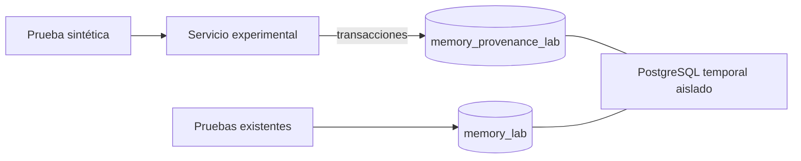

# Diseño: procedencia con PostgreSQL temporal

**Estado: primera implementación experimental probada en una base temporal.**
No altera el esquema `memory_lab`, sus volúmenes ni las sesiones actuales. La
política de identidad sigue siendo simulada; no es autenticación ni autorización
real. El [documento de ejecución](../experiments/provenance/POSTGRES.md) detalla
lo implementado; la [copia sintética](../tests/postgres_fixture/COPY-LAB.md)
se limita al fixture y no es una migración real.

## Objetivo y decisión de aislamiento

La [demostración en proceso](../experiments/provenance/README.md) muestra
afirmaciones, correcciones y reintentos mediante un bloqueo de Python. Ese
bloqueo no coordina procesos ni demuestra durabilidad. La siguiente prueba debe
comprobar esas propiedades con **conexiones PostgreSQL reales** y datos
sintéticos, antes de considerar cualquier integración con datos existentes.

Se propone un esquema nuevo, `memory_provenance_lab`, en la base temporal del
laboratorio. El esquema actual `memory_lab` seguirá siendo propiedad de su
implementación existente. El experimento tendrá sus propias tablas y un rol de
prueba separado; no importará sesiones antiguas automáticamente ni inferirá
afirmaciones de sus mensajes. No se necesita pgvector para esta prueba.

Los dos esquemas pueden convivir en la misma base efímera del *fixture*, pero
usan roles de ejecución distintos. Aislar esquemas y permisos en una prueba no
demuestra aislamiento entre usuarios ni convierte la política simulada en un
sistema de seguridad de producción.

## Alcance de la primera implementación

- Crear explícitamente el esquema experimental y su versión inicial **una sola
  vez** en la base de pruebas. Si ya existe, o su versión no coincide, fallar
  sin reemplazar tablas ni datos. La inicialización y creación de roles usan
  una conexión administrativa de prueba distinta del rol de ejecución.
- Ofrecer una clase experimental pequeña con sesiones, mensajes normales,
  confirmación y corrección, lectura actual, `clear` y `delete`. Reutilizar
  validaciones y selección existentes cuando corresponda; no introducir ORM,
  servicio web ni una abstracción general de almacenamiento.
- Generar mensajes canónicos con las mismas reglas de la demostración Python:
  claves permitidas, JSON determinista y límite de 4.000 puntos de código del
  mensaje resultante. Un mensaje normal no recibe procedencia automáticamente.
- Mantener el límite de **1.000 mensajes totales por sesión**, contando tanto
  los normales como los generados por afirmaciones. Respetar también los
  límites de caracteres y contexto del módulo actual.
- Simular la identidad con etiquetas sintéticas y una política local fija,
  igual que en la demostración. La etiqueta no demuestra quién llama ni da
  acceso seguro a una sesión; no usar este experimento con usuarios reales.

La API pública de `PostgresConversationMemory` y sus pruebas no cambian en
esta primera implementación. Sus sesiones y las experimentales son entidades
distintas, aunque por casualidad tengan el mismo UUID.

## Modelo de datos conceptual

Los nombres y restricciones siguientes describen la intención del primer esquema;
la implementación experimental se ha comprobado con PostgreSQL 16 temporal.
Los UUID los genera la aplicación, sin agregar extensiones. El contenido se conserva como
`bytea` UTF-8, igual que en Memory, para no perder NUL en mensajes normales.
La serialización JSON de afirmaciones escapa NUL; `bytea` no cifra datos.

| Tabla | Identidad y responsabilidad |
| --- | --- |
| `schema_version` | Una única versión explícita del esquema experimental; no intenta identificar o migrar `memory_lab`. |
| `sessions` | `session_id` y `generation`, con `session_id` único y unicidad compuesta para referenciar la generación actual. |
| `messages` | `session_id`, `generation`, `position`, `message_id`, `role`, `content_utf8`. Posición única dentro de una generación e ID de mensaje único. |
| `statements` | `statement_id`, sesión, generación, clave, `message_id`, actor simulado, hora, versión de política y predecesor opcional. Una afirmación apunta a un mensaje único de su misma generación; no se reutiliza ese mensaje para otra afirmación. |
| `current_statements` | Una fila por sesión, generación y clave, con el `statement_id` vigente. Permite consultar y comparar la versión esperada sin inferirla del tiempo. |
| `operations` | Sesión, generación, actor simulado, `operation_id` y afirmación resultante; la combinación de esos cuatro primeros campos es única para deduplicar. |

Las claves foráneas compuestas deben impedir referencias entre sesiones,
generaciones o claves: un predecesor y el puntero vigente deben pertenecer a la
misma clave y generación que la afirmación. Para ello se añadirán las claves
únicas compuestas que PostgreSQL exige como destino de esas referencias. Un
predecesor nulo indica una primera afirmación; el vínculo opcional usa la
semántica de nulidad prevista; las pruebas cubren una primera afirmación y una
referencia entre claves inválida. Las restricciones
de integridad no prueban que una afirmación sea verdadera ni que el actor
simulado esté autenticado.

El servicio comprueba bajo el bloqueo que el predecesor es la versión vigente,
es anterior y no es la propia afirmación. Las claves foráneas por sí solas no
imponen ese protocolo ni impiden que un escritor con permisos SQL suficientes
lo evite. La política del laboratorio presupone que todos los escritores
cooperan; las pruebas también deben mostrar este límite. No se promete una
cadena confiable frente a un cliente que acceda directamente con credenciales
capaces de modificar las tablas.

No hace falta duplicar el valor en `operations`: el mensaje canónico, la clave
y el predecesor asociados a la afirmación permiten comparar la solicitud
estable. `operations` conserva la versión de canonicalización usada para que
un cambio futuro de formato no altere silenciosamente la comparación. La versión
inicial fija claves ordenadas, separadores compactos y escapes ASCII, como
`preview` en la demostración. El reintento se compara con la versión registrada,
no con IDs o la hora asignados por el servidor. Una versión posterior tendría
que conservar la validación y canonicalización anteriores mientras admita sus
reintentos; si ya no puede hacerlo, debe fallar explícitamente en vez de
reinterpretar la solicitud. No se guarda el contenido en logs; el contenido
de la base sigue siendo sensible.

## Transacciones de escritura

Se usa una conexión por operación y una transacción `READ COMMITTED`, como en
el módulo PostgreSQL actual. Antes de consultar el estado que puede cambiar,
se adquiere `SELECT ... FOR UPDATE` sobre la fila de sesión. El bloqueo se
mantiene hasta terminar la transacción y serializa solo los escritores que
siguen ese protocolo. [Bloqueos de fila en PostgreSQL 16](https://www.postgresql.org/docs/16/explicit-locking.html#LOCKING-ROWS).

Para confirmar una afirmación o corrección:

1. La política **simulada** verifica la etiqueta del actor antes de consultar
   la sesión o revelar si existe una operación. El comando no acepta un campo
   de actor o rol. Esa comprobación no protege frente a suplantación real.
2. Validar tipos y mensaje canónico; abrir transacción, bloquear la sesión y
   verificar que la generación recibida es la actual. Una sesión inexistente
   o generación antigua falla sin cambios.
3. Buscar la operación por sesión, generación, actor y `operation_id`. Una
   solicitud estable idéntica devuelve su resultado anterior; si cambian clave,
   mensaje canónico o predecesor, produce conflicto. Esta búsqueda ocurre
   **antes** de comprobar cuál es la versión vigente o el límite de mensajes.
4. Si la operación es nueva, comprobar el predecesor actual de esa clave,
   contar todos los mensajes de la sesión y asignar la siguiente posición bajo
   el bloqueo. La primera afirmación requiere que no exista otra vigente; una
   corrección requiere exactamente el ID vigente. Superar 1.000 mensajes o
   encontrar una versión anterior produce error sin insertar nada.
5. Insertar el mensaje, la afirmación y su vínculo, insertar o actualizar el
   puntero vigente y registrar la operación **en la misma transacción**. Un
   error anterior al commit revierte todas esas escrituras. El servicio devuelve
   el resultado solo tras confirmar; si la respuesta se pierde después, un
   reintento con el mismo ID consulta el registro antes de intentar escribir.

Dos correcciones simultáneas basadas en la misma versión deben producir una
confirmación y un conflicto. Dos reintentos idénticos simultáneos deben devolver
el mismo resultado y crear un solo mensaje. Las restricciones únicas ofrecen
una defensa adicional, pero no sustituyen el bloqueo ni la comprobación de
versión. La serialización afecta a toda una sesión, incluso si se editan claves
distintas: es una elección sencilla para este laboratorio, no una evaluación
de rendimiento.

Si la conexión falla durante `COMMIT`, el resultado puede ser incierto. La
prueba puede simular una excepción **después de un commit confirmado** y verificar
el reintento; eso no reproduce todos los fallos de red ni garantiza *exactly
once*. El `operation_id` no autoriza al llamador, y la deduplicación se limita a
la generación activa y a los registros que todavía se conservan.

## Lecturas, vaciado y eliminación

La lectura de contexto y la lectura de una afirmación vigente usan una
transacción de solo lectura `REPEATABLE READ`: sesión, mensaje y procedencia
deben provenir de una misma instantánea. En `READ COMMITTED`, distintas
sentencias pueden ver commits distintos; [PostgreSQL documenta esa diferencia](https://www.postgresql.org/docs/16/transaction-iso.html).
Una lectura iniciada antes de un borrado puede terminar después con su
instantánea anterior; no se revocan datos ya entregados al consumidor.

`clear` y `delete` adquieren primero el mismo bloqueo de sesión. La propuesta
de prueba elimina explícitamente, dentro de la transacción, punteros vigentes,
operaciones, afirmaciones y mensajes de la generación, en ese orden. Las
afirmaciones de una generación se eliminan juntas; la relación de predecesor se
definirá de forma que esto sea posible y se verificará con una cadena real. Se
debe probar el comportamiento de las claves foráneas al borrar: `NO ACTION` y
`RESTRICT` no tienen exactamente la misma semántica de comprobación
([restricciones de PostgreSQL](https://www.postgresql.org/docs/16/ddl-constraints.html#DDL-CONSTRAINTS-FK)).

Después de `clear`, se asigna una generación nueva a la sesión vacía; la
actualización ocurre **después** de eliminar las filas que referencian la
generación anterior, antes del commit. `delete` elimina finalmente la sesión.
Recrear el mismo UUID produce otra generación. Las operaciones tardías de una
generación anterior fallan: no se garantiza deduplicación tras `clear` o
`delete`. Ninguna de estas acciones demuestra eliminación inmediata de copias
de seguridad ni borra lo que otro consumidor ya leyó.

## Plan de migración de sesiones existentes

**No se ejecutará una migración de datos reales en esta etapa.** La estrategia
propuesta es una copia explícita y verificable hacia una sesión nueva del
esquema experimental, manteniendo intacto el origen; no una modificación en
sitio ni una asignación de procedencia a textos antiguos.

1. Primero, validar en una base temporal un inicializador versionado del nuevo
   esquema y una utilidad de copia optativa. Rechazar versiones desconocidas,
   estructuras parciales o esquemas ya existentes; nunca usar `DROP` para
   resolver una discrepancia.
2. Detener y verificar la ausencia de escritores sobre la sesión de origen
   durante la copia. En la prueba, las dos estructuras están en la misma base
   temporal: una transacción con permisos de migración bloquea la fila de
   origen, lee su historial y crea una sesión de destino con generación e IDs
   de mensaje nuevos. El bloqueo solo coordina escritores que lo respetan; no
   evita que un cliente privilegiado ignore el protocolo.
3. Copiar roles, orden y bytes de contenido, sin normalizarlos, respetando los
   límites actuales y validando UTF-8 de forma estricta. Si existen datos
   inválidos, una posición inesperada, más de 1.000 mensajes o falla cualquier
   inserción, revertir el destino completo y conservar el origen. A los
   mensajes copiados no se les asignan afirmaciones ni actores retroactivos.
4. Comparar cantidad, orden, bytes y resultados de contexto entre origen y
   destino con datos sintéticos, incluidos NUL y emoji. Verificar que nuevas
   afirmaciones del destino no alteran el origen y viceversa. Una vez reanudados
   escritores en el origen, las copias pueden divergir: no hay sincronización
   ni redirección automáticas.
5. Antes de contemplar una copia o cambio de tráfico en un entorno real, definir
   respaldo y restauración verificados, permisos, ventana de mantenimiento,
   compatibilidad y plan de retorno. Esa decisión y su ejecución requieren una
   fase posterior; este diseño no autoriza ni inicia una migración real.

Una integración en el esquema actual sería otra decisión de diseño. En
particular, `clear()` actual permite que otra instancia existente siga usando la
sesión, mientras que el prototipo de procedencia rechaza generaciones antiguas.
No se puede prometer compatibilidad de comportamiento simplemente añadiendo una
columna. También habría que retirar o actualizar **todos** los escritores
antiguos; uno que vacíe sin actualizar la generación puede invalidar la
garantía. Mantener la API antigua para sus sesiones y experimentar en un esquema
separado evita ocultar esa ruptura pendiente.

## Laboratorio y pruebas de aceptación

Extender el *fixture* Docker existente para crear una base efímera exclusiva,
con credenciales sintéticas nuevas y datos en `tmpfs`. Inicializar primero el
esquema existente y después el experimental, con roles de ejecución separados;
ejecutar sus suites por separado con sus propias variables de conexión. El
*fixture* ejecuta explícitamente las suites del esquema existente, procedencia
y copia sintética. No usa el volumen de desarrollo ni el de RAG. Al terminar
normalmente se detiene y elimina el contenedor; una terminación forzada puede
impedir esa limpieza.

Las pruebas propuestas deben cubrir, como mínimo:

1. Inicialización y versión: primer arranque, segundo intento, fallo inyectado
   durante creación y esquema incompatible, todos sin borrar datos existentes.
   Comprobar que los roles efectivos no pueden crear o truncar tablas ni acceder
   al otro esquema; revisar también privilegios heredados o concedidos a
   `PUBLIC` dentro de la base temporal.
2. Paridad con la demostración en proceso: mensaje canónico, primera afirmación,
   corrección, claves independientes, predecesor de otra clave o generación,
   UTF-8, NUL y límite de mensajes. Las pruebas sin PostgreSQL deben seguir
   funcionando sin Psycopg instalado.
3. Dos conexiones y barreras explícitas: correcciones competidoras, reintentos
   simultáneos de un mismo ID, escritura cerca del límite y operaciones de
   distintas sesiones. Comprobar una sola escritura confirmada cuando aplique,
   el conflicto esperado y que una sesión no afecte a otra.
4. Fallos inyectados después de cada inserción y antes de commit: ninguna fila
   parcial. Simular pérdida de confirmación **después de commit** y verificar la
   repetición exacta y el conflicto ante un contenido distinto.
5. `clear` y `delete` durante escrituras y lecturas coordinadas; cambio de
   generación, reuso de UUID y lecturas con instantáneas previas. Probar el
   borrado de una cadena de varias correcciones y la ausencia de operaciones
   huérfanas.
6. Copia experimental de una sesión antigua vacía y otra con varios mensajes,
   comparación exacta sin procedencia inventada, fallo a mitad de copia y
   preservación del origen. No copiar datos del usuario para probarlo.
7. Entradas inválidas, credenciales ausentes, fallos de conexión, tiempo de
   bloqueo agotado, datos corruptos y errores sin texto ni secretos. Usar
   límites de conexión y sentencia explícitos, documentando que no son un plazo
   total de red.

Las concesiones del rol experimental deben ser las mínimas necesarias para
estas operaciones y verificarse con el rol real de prueba. `SELECT ... FOR
UPDATE` requiere privilegios de actualización apropiados; concederlos no
impide por sí solo que el mismo rol intente SQL fuera del protocolo.

## Estado y siguiente fase propuesta

El esquema experimental, las operaciones mínimas y una copia de historiales
sintéticos están implementados y probados en PostgreSQL temporal. El esquema y
la API existentes siguen intactos. Una utilidad de migración real, sus
permisos, la reconciliación y el cambio de tráfico requerirían otra fase y
aprobación; no se propone desplegar ni usar datos reales.
