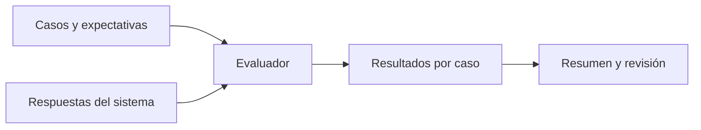

# 04 — Evals: fundamentos y diseño inicial

**Estado: MVP local de coincidencia exacta implementado.** Trabaja con
respuestas sintéticas ya registradas, sin llamar a un modelo ni a otro
proyecto del monorepo. No evalúa todavía sustento, seguridad o latencia.

## Qué problema resuelve

Una respuesta que parece convincente puede ser incorrecta, no estar sustentada
por la evidencia, tardar demasiado o incumplir una regla importante. Una
evaluación convierte ejemplos y criterios explícitos en resultados que se pueden
inspeccionar y comparar. Ninguna puntuación individual demuestra por sí sola
que un sistema LLM sea correcto o seguro en todas las situaciones.

Un ciclo básico es:



Cada caso debe representar un comportamiento deseado y tener una regla de
evaluación apropiada. La expectativa puede ser una respuesta exacta, una fuente
necesaria, un formato válido o una valoración humana. Un caso también puede
carecer de respuesta esperada: ese escenario requiere definir explícitamente
qué se considera una abstención aceptable.

## Dimensiones distintas

| Dimensión | Pregunta | Ejemplo de medición futura | Lo que no demuestra |
| --- | --- | --- | --- |
| Exactitud de respuesta | ¿Responde correctamente a la pregunta? | Comparación exacta cuando el contrato exige una cadena concreta; revisión humana para respuestas abiertas. | Que una respuesta distinta sea incorrecta si solo cambia la redacción. |
| Recuperación | ¿Se encontró la evidencia pertinente? | Hit@k o MRR@k con fuentes etiquetadas y casos sin respuesta separados. | Que el modelo haya usado la evidencia o contestado correctamente. |
| Sustento | ¿Las afirmaciones de la respuesta están apoyadas por la evidencia? | Revisión de afirmaciones frente a fragmentos; posteriormente, un juez evaluado contra personas. | Que la fuente sea verdadera o que un juez automático sea infalible. |
| Rendimiento y fiabilidad | ¿Cuánto tarda y con qué frecuencia falla? | Latencia de llamadas reales, tasa de error y, si están disponibles, tokens y coste. | Que una medición de respuestas guardadas represente la latencia de un modelo. |
| Seguridad | ¿Cumple reglas concretas bajo entradas relevantes para el caso de uso? | Casos adversariales y revisión humana con resultados desglosados. | Que el sistema sea seguro frente a todos los ataques. |

El enfoque de [HELM](https://arxiv.org/abs/2211.09110) ilustra por qué conviene
comparar varias dimensiones y escenarios. En RAG, [RAGAS](https://aclanthology.org/2024.eacl-demo.16/)
estudia medidas separadas para recuperación y generación. Son referencias para
aprender; no se propone añadir esos frameworks al MVP.

## Relación con lo que ya existe

- `01-rag` ya calcula Hit@k y MRR@k por fuente y registra respuestas para
  revisión; su evaluador por API cuenta los casos `no_context`. No califica
  automáticamente la corrección o el sustento de respuestas abiertas.
- `03-memory` ya compara recencia y una candidata léxica, con casos y métricas
  específicas de memoria. Sus corpus son sintéticos y no tienen revisión
  independiente; los resultados no demuestran robustez general.
- `04-evals` es independiente. El primer MVP **no importa código ni datos**
  de esos proyectos. Una futura integración deberá acordar un formato o un
  adaptador explícito; no se trasladan resultados de RAG o Memory sin revisar
  sus diferencias de contrato y etiquetas.

Esta separación evita que una evaluación general dependa de la base de datos,
los modelos o el estado interno de otro proyecto. No se propone sustituir los
evaluadores existentes ni crear una capa de adaptadores antes de necesitarla.

## Arquitectura del primer MVP

Un programa Python local lee dos archivos JSONL: casos sintéticos con una
expectativa literal y respuestas ya producidas. Une los registros por ID,
compara cadenas y emite un único informe JSON. Es un evaluador de **coincidencia
exacta**, no un verificador general de corrección, seguridad o sustento.

```text
04-evals/
  README.md                     # fundamentos, contrato y ejecución
  src/evals_lab/
    __init__.py
    cases.py                    # lectura y validación de JSONL
    evaluate.py                 # comparación y agregación
    __main__.py                 # ejecución local
  examples/                     # casos y respuestas sintéticos
  tests/                        # pruebas con unittest
```

La división es modular y pequeña: lectura, cálculo y entrada por terminal
tienen responsabilidades distintas. Usa la biblioteca estándar de Python
3.10 o superior; no necesita framework, base de datos ni interfaz web. No se
introduce una interfaz abstracta para proveedores hasta tener una segunda
integración concreta. Docker y GitHub Actions se prepararán en una etapa
posterior, cuando exista comportamiento que comprobar.

## Contrato del MVP

### Entradas

Los archivos son UTF-8 sin BOM, con un objeto JSON por línea. El archivo de
casos no puede estar vacío; el archivo de respuestas puede estar vacío para
representar una ejecución que no produjo ninguna respuesta. No se admiten
líneas en blanco ni campos duplicados en un objeto. Cada archivo tiene un
máximo de 2 MiB y cada línea un máximo de 65.536 bytes, sin contar su terminador
LF o CRLF. Como máximo se evalúan 1.000 casos o 1.000 respuestas.

Cada caso tiene exactamente `id`, `input` y `expected_output`; cada respuesta
tiene exactamente `id` y `output`. El campo `input` documenta la entrada que
corresponde al caso, pero este MVP no la envía a ningún sistema. Los IDs son únicos en cada archivo y cumplen
`[a-z0-9][a-z0-9_-]{0,63}`. Las respuestas deben referirse a IDs de casos
existentes. Los valores de texto son cadenas UTF-8 válidas de hasta 4.000
puntos de código; se permite una cadena vacía. Se admiten caracteres como NUL
o salto de línea **dentro del valor JSON escapado**, no como separadores sin
escapar. No se aceptan sustitutos Unicode no codificables en UTF-8.

Ejemplo de casos:

```jsonl
{"id":"ubicacion","input":"¿Dónde está la sede?","expected_output":"La Paz"}
{"id":"estado","input":"Indica el estado.","expected_output":"OK"}
{"id":"ausente","input":"Indica el dato ausente.","expected_output":"No disponible"}
```

Ejemplo de respuestas:

```jsonl
{"id":"ubicacion","output":"La Paz"}
{"id":"estado","output":"error"}
```

El orden de las respuestas no afecta el emparejamiento. El informe conserva el
orden del archivo de casos. La comparación usa igualdad exacta de las cadenas
Python: distingue mayúsculas, espacios, saltos y formas Unicode sin normalizar.
Por ejemplo, `"OK"` y `"ok"` no coinciden; dos respuestas semánticamente
equivalentes también pueden diferir. No se ejecuta ni interpreta como código el
contenido de los archivos.

### Resultado y errores

Cada caso produce uno de tres estados:

| Estado | Significado |
| --- | --- |
| `passed` | Existe una respuesta y coincide exactamente. |
| `failed` | Existe una respuesta válida, pero no coincide. |
| `error` | No se recibió una respuesta para ese caso; código `missing_response`. |

La ausencia de respuesta no se oculta ni se cuenta como comparación válida. El
resumen informa `total`, `passed`, `failed` y `errors`, más:

- `exact_match_valid`: `passed / (passed + failed)`; es `null` si no hay
  respuestas válidas. Se presenta junto al denominador y los errores.
- `pass_rate_all`: `passed / total`; cuenta todos los casos en el denominador
  para que omitir respuestas no mejore la tasa de casos superados.

Con los ejemplos anteriores, el resultado es un caso de cada estado,
`exact_match_valid = 0.5` y `pass_rate_all = 1/3`. El informe contiene estos
campos (los valores de hash se muestran como marcadores ilustrativos):

```json
{
  "schema_version": 1,
  "dataset_sha256": "<sha256 de casos>",
  "outputs_sha256": "<sha256 de respuestas>",
  "total": 3,
  "passed": 1,
  "failed": 1,
  "errors": 1,
  "valid_responses": 2,
  "exact_match_valid": 0.5,
  "pass_rate_all": 0.3333333333333333,
  "cases": [
    {"id": "ubicacion", "status": "passed", "error_code": null},
    {"id": "estado", "status": "failed", "error_code": null},
    {"id": "ausente", "status": "error", "error_code": "missing_response"}
  ]
}
```

El informe incluye el ID y estado de cada caso, sin imprimir entradas,
expectativas ni respuestas. Sus hashes identifican los **bytes** de ambos
archivos; un cambio de finales de línea cambia el hash.
Esos hashes no autentican los datos y pueden revelar si un contenido predecible
coincide con otro. El MVP usará solo ejemplos sintéticos y no necesita secretos.

Para las mismas entradas en bytes, el informe será determinista: no incluirá
hora, duración, IDs aleatorios ni datos del entorno. La salida JSON usará claves
ordenadas, escapes ASCII, separadores compactos y un único salto de línea LF.
Una entrada mal formada, un ID duplicado o inesperado, un límite excedido o un
error de lectura detienen la ejecución **antes de publicar un informe**. Una
interrupción de stdout durante la escritura podría dejar una salida parcial.
Los mensajes de error no
incluyen contenido de entrada ni rutas. Un error de implementación inesperado
debe terminar con error, no convertirse en `failed` ni en éxito.

Los códigos de salida son `0` si todos los casos pasan, `1` si hay
al menos un `failed` o `error`, y `2` si la entrada es inválida o no se puede
completar la evaluación. La salida JSON de una evaluación válida se imprime en
stdout, incluso cuando el código es `1`; los errores de ejecución van a stderr.
La opción `--help` muestra la ayuda y termina con código `0`.

### Ejecución local

Desde `04-evals`, en PowerShell:

```powershell
$env:PYTHONPATH = Join-Path (Get-Location) 'src'
python -m evals_lab --cases examples/cases.jsonl --outputs examples/outputs.jsonl
```

Los archivos de ejemplo incluyen cuatro casos: dos pasan, uno difiere y uno
no tiene respuesta. El comando emite un informe con `exact_match_valid` igual
a `2/3`, `pass_rate_all` igual a `1/2` y termina con código `1`, como resultado
esperado para este ejemplo. Puedes consultar `$LASTEXITCODE` inmediatamente
después de ejecutarlo. Los datos y etiquetas son sintéticos, creados por el
asistente y sin revisión humana independiente; no miden un modelo real.

Para ejecutar las pruebas sin dependencias externas:

```powershell
python -S -m unittest discover -s tests -v
```

Las pruebas cubren coincidencias, ausencias, cadenas vacías, Unicode, límites
de archivos y registros, errores de entrada, códigos de salida y que el informe
no muestre texto ni rutas. También ejecutan el programa desde otro directorio.

## Conjuntos y calidad de la evaluación

El conjunto inicial es pequeño y sintético, con casos que demuestran
coincidencia, diferencia, respuesta vacía y ausencia de respuesta. No permite
hacer una afirmación estadística sobre la calidad de un modelo.

Para evaluaciones posteriores se separarán desarrollo y evaluación reservada por
familia de caso, fijando reglas y parámetros antes de inspeccionar la reserva.
Si se ajusta el evaluador usando esa reserva, deja de ser independiente y hace
falta otra. Los fallos, abstenciones y casos sin etiqueta deben tener sus
propios denominadores; no se interpretan como respuestas correctas por defecto.
Una media puede ocultar fallos graves en un subconjunto, por lo que se
conservarán resultados individuales y, cuando existan suficientes casos,
desgloses por categoría.

## Evolución posterior, sujeta a aprobación

1. **MVP local — implementado.** Coincidencia exacta, ejemplos sintéticos y
   pruebas de validación, denominadores, errores y códigos de salida. No llama
   a modelos ni necesita datos reales.
2. **Pruebas y distribución.** Una vez probado el MVP, preparar CI y una forma
   de ejecución en Docker si aportan valor. No publicar ni desplegar por defecto.
3. **Medidas e integración.** Añadir métricas de recuperación y un adaptador
   para un contrato real de RAG o Memory solo después de definir sus entradas y
   denominadores. Medir latencia con llamadas reales y reloj monotónico; registrar
   configuración y errores. Tokens y coste solo cuando se disponga de datos y
   precios explícitos de la ejecución.
4. **Jueces y frameworks.** Explorar Ollama o OpenAI como opciones configurables
   y comparar una rúbrica de juez con revisión humana antes de adoptarla. Los
   jueces pueden mostrar sesgos de posición, longitud o preferencia por sus
   propias respuestas ([Zheng et al.](https://arxiv.org/abs/2306.05685)).
   Evaluar RAGAS u otro framework únicamente frente a una necesidad medida,
   conservando casos y resultados revisables.

Cada etapa necesita aprobación antes de comenzar. La siguiente etapa propuesta
es preparar las pruebas automatizadas y la distribución del punto 2.
