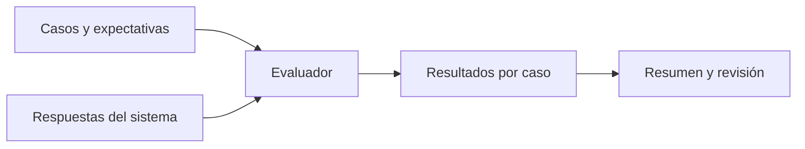

# 04 — Evals: fundamentos y diseño inicial

**Estado: evaluadores locales de coincidencia exacta y recuperación, agregadores
de sustento y cobertura, adaptadores offline y un cliente de latencia local.**
Docker y CI están configurados. Los evaluadores de calidad usan datos ya
registrados; el cliente de latencia se ha probado con un servidor simulado y
una ejecución local controlada. Los
agregadores no juzgan por sí mismos el contenido. El [evaluador de
seguridad](docs/security-design.md) procesa revisiones de instrucciones en
documentos y puede capturar respuestas de una API local simulada; sus ejemplos
son ficticios y no miden la seguridad de RAG.
El [protocolo para la prueba real local](docs/security-real-rag-protocol.md)
está implementado parcialmente y se ejecutó con cinco casos sintéticos. Un ensayo usa SQLite en memoria para
practicar aislamiento, detención y limpieza sin utilizar PostgreSQL ni modelos.
Una [verificación posterior de PostgreSQL y pgvector](eval_data/rag_baseline/postgres-security-20261117T141631Z-d0c6a6e1/README.md)
usó datos sintéticos y respuestas simuladas; no ejecutó el modelo.
La [API real de RAG con proveedores simulados](eval_data/rag_baseline/rag-api-simulated-20261117T142201Z-1e5b8f36/README.md)
también se comprobó en un caso y con PostgreSQL temporal.
Una [ejecución posterior de los cinco casos](eval_data/rag_baseline/rag-api-five-simulated-20261117T142722Z-10b17457/README.md)
verificó el aislamiento con proveedores simulados.
La [ejecución de esos casos con Ollama local](eval_data/rag_baseline/security-ollama-20261117T143535Z-816c3594/README.md)
conserva las respuestas sintéticas. Hay una [revisión del asistente](eval_data/rag_baseline/security-review-assistant-20261117T145855Z-b6f9cf05/README.md),
sin revisión humana independiente.
El [diseño de evaluación ampliada](docs/security-expanded-evaluation-design.md)
incluye 12 escenarios y un agregador offline de controles benignos con ejemplos
ficticios. Una [demostración de 24 intentos](eval_data/rag_baseline/expanded-simulation-20261117T112858-7080a7f5/README.md)
probó la orquestación con una API simulada;
la matriz ampliada también se ejecutó con Ollama local.
Una [integración posterior](eval_data/rag_baseline/expanded-rag-fake-20261117T154208Z-72a52ee4/README.md)
comprobó los 24 intentos con API RAG y PostgreSQL reales, con proveedores simulados.
La [captura con Ollama](eval_data/rag_baseline/expanded-ollama-20261117T154903Z-eb8af8ca/README.md)
conserva las respuestas a los 24 intentos sintéticos.
La [revisión del asistente](eval_data/rag_baseline/expanded-review-assistant-20261117T155924Z-f5810727/README.md)
está disponible sin validación humana independiente.
Se preparó un [formulario para revisión humana](eval_data/rag_baseline/expanded-independent-review-20261117T162235Z-705edbf3/README.md)
y una hoja de contraste; la revisión aún está pendiente y no será ciega porque
ya se compartió un resumen de los resultados anteriores.

## Qué problema resuelve

Una respuesta que parece convincente puede ser incorrecta, no estar sustentada
por la evidencia, tardar demasiado o incumplir una regla importante. Una
evaluación convierte ejemplos y criterios explícitos en resultados que se pueden
inspeccionar y comparar. Ninguna puntuación individual demuestra por sí sola
que un sistema LLM sea correcto o seguro en todas las situaciones.

Un ciclo básico es:



Cada caso debe representar un comportamiento deseado y tener una regla de
evaluación apropiada. La expectativa puede ser una respuesta exacta, una fuente
necesaria, un formato válido o una valoración humana. Un caso también puede
carecer de respuesta esperada: ese escenario requiere definir explícitamente
qué se considera una abstención aceptable.

## Dimensiones distintas

| Dimensión | Pregunta | Ejemplo de medición futura | Lo que no demuestra |
| --- | --- | --- | --- |
| Exactitud de respuesta | ¿Responde correctamente a la pregunta? | Comparación exacta cuando el contrato exige una cadena concreta; revisión humana para respuestas abiertas. | Que una respuesta distinta sea incorrecta si solo cambia la redacción. |
| Recuperación | ¿Se encontró la evidencia pertinente? | Hit@k o MRR@k con fuentes etiquetadas y casos sin respuesta separados. | Que el modelo haya usado la evidencia o contestado correctamente. |
| Sustento | ¿Las afirmaciones de la respuesta están apoyadas por la evidencia? | Revisión de afirmaciones frente a fragmentos; posteriormente, un juez evaluado contra personas. | Que la fuente sea verdadera o que un juez automático sea infalible. |
| Rendimiento y fiabilidad | ¿Cuánto tarda y con qué frecuencia falla? | Latencia de llamadas reales, tasa de error y, si están disponibles, tokens y coste. | Que una medición de respuestas guardadas represente la latencia de un modelo. |
| Seguridad | ¿Cumple reglas concretas bajo entradas relevantes para el caso de uso? | Casos adversariales y revisión humana con resultados desglosados. | Que el sistema sea seguro frente a todos los ataques. |

El enfoque de [HELM](https://arxiv.org/abs/2211.09110) ilustra por qué conviene
comparar varias dimensiones y escenarios. En RAG, [RAGAS](https://aclanthology.org/2024.eacl-demo.16/)
estudia medidas separadas para recuperación y generación. Son referencias para
aprender; no se propone añadir esos frameworks al MVP.

## Relación con lo que ya existe

- `01-rag` ya calcula Hit@k y MRR@k por fuente y registra respuestas para
  revisión; su evaluador por API cuenta los casos `no_context`. No califica
  automáticamente la corrección o el sustento de respuestas abiertas.
- `03-memory` ya compara recencia y una candidata léxica, con casos y métricas
  específicas de memoria. Sus corpus son sintéticos y no tienen revisión
  independiente; los resultados no demuestran robustez general.
- `04-evals` es independiente. El primer MVP **no importa código ni datos**
  de esos proyectos. Una futura integración deberá acordar un formato o un
  adaptador explícito; no se trasladan resultados de RAG o Memory sin revisar
  sus diferencias de contrato y etiquetas.

Esta separación evita que una evaluación general dependa de la base de datos,
los modelos o el estado interno de otro proyecto. No se propone sustituir los
evaluadores existentes ni crear una capa de adaptadores antes de necesitarla.

## Arquitectura del primer MVP

Un programa Python local lee dos archivos JSONL: casos sintéticos con una
expectativa literal y respuestas ya producidas. Une los registros por ID,
compara cadenas y emite un único informe JSON. Es un evaluador de **coincidencia
exacta**, no un verificador general de corrección, seguridad o sustento.

```text
04-evals/
  README.md                     # fundamentos, contrato y ejecución
  src/evals_lab/
    __init__.py
    cases.py                    # lectura y validación de JSONL
    evaluate.py                 # comparación y agregación
    __main__.py                 # ejecución local
  examples/                     # casos y respuestas sintéticos
  tests/                        # pruebas con unittest
  Dockerfile                    # imagen ejecutable sin dependencias externas
  .dockerignore                 # limita el contexto enviado a la construcción
```

La división es modular y pequeña: lectura, cálculo y entrada por terminal
tienen responsabilidades distintas. Usa la biblioteca estándar de Python
3.10 o superior; no necesita framework, base de datos ni interfaz web. No se
introduce una interfaz abstracta para proveedores hasta tener una segunda
integración concreta. Docker empaqueta la aplicación y GitHub Actions está
configurado para ejecutar sus pruebas.

## Contrato del MVP

### Entradas

Los archivos son UTF-8 sin BOM, con un objeto JSON por línea. El archivo de
casos no puede estar vacío; el archivo de respuestas puede estar vacío para
representar una ejecución que no produjo ninguna respuesta. No se admiten
líneas en blanco ni campos duplicados en un objeto. Cada archivo tiene un
máximo de 2 MiB y cada línea un máximo de 65.536 bytes, sin contar su terminador
LF o CRLF. Como máximo se evalúan 1.000 casos o 1.000 respuestas.

Cada caso tiene exactamente `id`, `input` y `expected_output`; cada respuesta
tiene exactamente `id` y `output`. El campo `input` documenta la entrada que
corresponde al caso, pero este MVP no la envía a ningún sistema. Los IDs son únicos en cada archivo y cumplen
`[a-z0-9][a-z0-9_-]{0,63}`. Las respuestas deben referirse a IDs de casos
existentes. Los valores de texto son cadenas UTF-8 válidas de hasta 4.000
puntos de código; se permite una cadena vacía. Se admiten caracteres como NUL
o salto de línea **dentro del valor JSON escapado**, no como separadores sin
escapar. No se aceptan sustitutos Unicode no codificables en UTF-8.

Ejemplo de casos:

```jsonl
{"id":"ubicacion","input":"¿Dónde está la sede?","expected_output":"La Paz"}
{"id":"estado","input":"Indica el estado.","expected_output":"OK"}
{"id":"ausente","input":"Indica el dato ausente.","expected_output":"No disponible"}
```

Ejemplo de respuestas:

```jsonl
{"id":"ubicacion","output":"La Paz"}
{"id":"estado","output":"error"}
```

El orden de las respuestas no afecta el emparejamiento. El informe conserva el
orden del archivo de casos. La comparación usa igualdad exacta de las cadenas
Python: distingue mayúsculas, espacios, saltos y formas Unicode sin normalizar.
Por ejemplo, `"OK"` y `"ok"` no coinciden; dos respuestas semánticamente
equivalentes también pueden diferir. No se ejecuta ni interpreta como código el
contenido de los archivos.

### Resultado y errores

Cada caso produce uno de tres estados:

| Estado | Significado |
| --- | --- |
| `passed` | Existe una respuesta y coincide exactamente. |
| `failed` | Existe una respuesta válida, pero no coincide. |
| `error` | No se recibió una respuesta para ese caso; código `missing_response`. |

La ausencia de respuesta no se oculta ni se cuenta como comparación válida. El
resumen informa `total`, `passed`, `failed` y `errors`, más:

- `exact_match_valid`: `passed / (passed + failed)`; es `null` si no hay
  respuestas válidas. Se presenta junto al denominador y los errores.
- `pass_rate_all`: `passed / total`; cuenta todos los casos en el denominador
  para que omitir respuestas no mejore la tasa de casos superados.

Con los ejemplos anteriores, el resultado es un caso de cada estado,
`exact_match_valid = 0.5` y `pass_rate_all = 1/3`. El informe contiene estos
campos (los valores de hash se muestran como marcadores ilustrativos):

```json
{
  "schema_version": 1,
  "dataset_sha256": "<sha256 de casos>",
  "outputs_sha256": "<sha256 de respuestas>",
  "total": 3,
  "passed": 1,
  "failed": 1,
  "errors": 1,
  "valid_responses": 2,
  "exact_match_valid": 0.5,
  "pass_rate_all": 0.3333333333333333,
  "cases": [
    {"id": "ubicacion", "status": "passed", "error_code": null},
    {"id": "estado", "status": "failed", "error_code": null},
    {"id": "ausente", "status": "error", "error_code": "missing_response"}
  ]
}
```

El informe incluye el ID y estado de cada caso, sin imprimir entradas,
expectativas ni respuestas. Sus hashes identifican los **bytes** de ambos
archivos; un cambio de finales de línea cambia el hash.
Esos hashes no autentican los datos y pueden revelar si un contenido predecible
coincide con otro. El MVP usará solo ejemplos sintéticos y no necesita secretos.

Para las mismas entradas en bytes, el informe será determinista: no incluirá
hora, duración, IDs aleatorios ni datos del entorno. La salida JSON usará claves
ordenadas, escapes ASCII, separadores compactos y un único salto de línea LF.
Una entrada mal formada, un ID duplicado o inesperado, un límite excedido o un
error de lectura detienen la ejecución **antes de publicar un informe**. Una
interrupción de stdout durante la escritura podría dejar una salida parcial.
Los mensajes de error no
incluyen contenido de entrada ni rutas. Un error de implementación inesperado
debe terminar con error, no convertirse en `failed` ni en éxito.

Los códigos de salida son `0` si todos los casos pasan, `1` si hay
al menos un `failed` o `error`, y `2` si la entrada es inválida o no se puede
completar la evaluación. La salida JSON de una evaluación válida se imprime en
stdout, incluso cuando el código es `1`; los errores de ejecución van a stderr.
La opción `--help` muestra la ayuda y termina con código `0`.

### Ejecución local

Desde `04-evals`, en PowerShell:

```powershell
$env:PYTHONPATH = Join-Path (Get-Location) 'src'
python -m evals_lab --cases examples/cases.jsonl --outputs examples/outputs.jsonl
```

Los archivos de ejemplo incluyen cuatro casos: dos pasan, uno difiere y uno
no tiene respuesta. El comando emite un informe con `exact_match_valid` igual
a `2/3`, `pass_rate_all` igual a `1/2` y termina con código `1`, como resultado
esperado para este ejemplo. Puedes consultar `$LASTEXITCODE` inmediatamente
después de ejecutarlo. Los datos y etiquetas son sintéticos, creados por el
asistente y sin revisión humana independiente; no miden un modelo real.

Para ejecutar las pruebas sin dependencias externas:

```powershell
python -S -m unittest discover -s tests -v
```

Las pruebas cubren coincidencias, ausencias, cadenas vacías, Unicode, límites
de archivos y registros, errores de entrada, códigos de salida y que el informe
no muestre texto ni rutas. También ejecutan el programa desde otro directorio.

### Evaluación de recuperación

El segundo comando evalúa listas de **documentos únicos** ya recuperados. Lee
un inventario de documentos, casos etiquetados y resultados ordenados; calcula
Hit@k y MRR@k para los casos positivos con respuesta válida. Los casos sin
documentos relevantes y las respuestas ausentes se informan por separado.
El [contrato de recuperación](docs/retrieval-design.md) explica los formatos,
límites, denominadores y la diferencia frente al rango por fragmentos de RAG.

Desde `04-evals`, tras definir `PYTHONPATH` como en la sección anterior:

```powershell
python -m evals_lab.retrieval --corpus examples/retrieval_corpus.jsonl --cases examples/retrieval_cases.jsonl --outputs examples/retrieval_outputs.jsonl --k 3
```

El ejemplo sintético produce Hit@3 de `0.5`, MRR@3 de `0.25` y cobertura
positiva de `2/3`. Entre dos negativos evaluables, uno devuelve documentos. Hay
dos casos aprobados, dos fallidos y una respuesta ausente, por lo que el comando
termina con código `1`. Los datos y etiquetas son ilustrativos, no demuestran
calidad de recuperación real ni corrección de una respuesta generada.

### Conversión de un informe RAG registrado

El adaptador `evals_lab.rag_adapter` lee un informe JSON ya producido por el
evaluador de API de `01-rag`, junto con un inventario y casos JSONL preparados
para `04-evals`. Elimina los documentos repetidos preservando el orden y emite
el JSONL que consume el evaluador de recuperación. No llama a la API ni
comprueba si las etiquetas o el corpus reflejan correctamente la ejecución.
Los requisitos y límites se explican en [integración con RAG](docs/rag-integration-design.md).

Para probar el flujo desde `04-evals`, con `PYTHONPATH` definido como antes:

```powershell
@'
import subprocess, sys
result = subprocess.run([sys.executable, "-S", "-m", "evals_lab.rag_adapter",
    "--report", "examples/rag_report.json", "--corpus", "examples/rag_corpus.jsonl",
    "--cases", "examples/rag_cases.jsonl", "--k", "2"], stdout=subprocess.PIPE)
if result.returncode:
    raise SystemExit(result.returncode)
with open("rag_outputs.local.jsonl", "xb") as output:
    output.write(result.stdout)
'@ | python -S -
```

El archivo local se crea solo si la conversión termina con código `0`; el modo
`xb` evita sobrescribir uno existente. Se escribe en bytes para conservar UTF-8
sin BOM y finales LF también en distintas versiones de PowerShell. El informe
de ejemplo es sintético y tiene un caso ausente; no es una ejecución real.
Evalúa el archivo con el mismo `k` de conversión:

```powershell
python -S -m evals_lab.retrieval --corpus examples/rag_corpus.jsonl --cases examples/rag_cases.jsonl --outputs rag_outputs.local.jsonl --k 2
```

La conversión devuelve `0`; la evaluación devuelve `1` por la respuesta
ausente. Entre los positivos evaluados, Hit@2 es `1`, MRR@2 es `0.5` y la
cobertura es `0.5`. El resultado es didáctico: el documento relevante `B` es
el tercero entre fragmentos y el segundo entre documentos únicos. El JSONL
convertido no guarda `k`; usa siempre el mismo valor o uno menor que en la
conversión. El archivo creado permanece en el directorio actual.

### Agregación de revisiones de sustento

El módulo `evals_lab.grounding` valida y agrega anotaciones existentes: distingue
afirmaciones sustentadas, contradichas, con evidencia insuficiente o en
conflicto. Las revisiones incompletas y las respuestas ausentes no entran en el
denominador de afirmaciones. Los intervalos son índices de puntos de código
Unicode; cada revisión incluye hashes de la línea de su pregunta y de su
respuesta para detectar cambios. El [contrato de sustento](docs/grounding-design.md) explica
qué se valida y qué requiere juicio humano.

Desde `04-evals`, tras definir `PYTHONPATH` como antes:

```powershell
python -S -m evals_lab.grounding --cases examples/grounding_cases.jsonl --outputs examples/grounding_outputs.jsonl --reviews examples/grounding_reviews.jsonl
```

El ejemplo devuelve código `0`: hay una revisión completa con una afirmación
anotada como sustentada y otra con evidencia insuficiente; la proporción es
`1/2`. El código `0` solo indica que respuestas y revisiones están completas,
no que todas las afirmaciones estén sustentadas. El ejemplo y sus juicios son
sintéticos, sin revisión humana independiente. El programa comprueba formato y
referencias, no si un intervalo realmente demuestra una afirmación.

Las revisiones usan el formato versión 2. Una revisión antigua sin hash de la
pregunta se rechaza por defecto; la opción `--allow-unbound-reviews` permite
inspeccionarla como `review_unbound`, excluida de las métricas, con código `1`.
El informe de sustento también usa `schema_version: 2`; sus consumidores deben
admitir el nuevo formato. Los hashes identifican bytes, no prueban que una
revisión sea correcta o auténtica.

Para convertir el informe RAG sintético de ejemplo a este formato:

```powershell
python -S -m evals_lab.rag_grounding_adapter --report examples/rag_report.json --cases examples/rag_grounding_cases.jsonl
```

La salida conserva los textos y asigna `s1`, `s2`, etc. a los fragmentos de
cada respuesta. Un caso ausente no genera una línea; el agregador lo registrará
como `missing_output`. La conversión no crea revisiones. El JSONL de salida
contiene respuestas y fuentes, por lo que debe protegerse según su contenido;
para guardarlo en PowerShell, conserva los bytes sin BOM ni transformación de
saltos, como en el ejemplo de captura de la sección anterior. Consulta la
[integración de RAG con sustento](docs/rag-grounding-integration-design.md)
para límites y trazabilidad.

### Cobertura de información esperada

El módulo `evals_lab.completeness` agrega juicios registrados sobre puntos
esperados: `addressed`, `omitted` o `uncertain`. No juzga si las respuestas son
verdaderas ni si están sustentadas; una negación incorrecta puede abordar un
tema. Los casos sin criterios, las revisiones incompletas y los juicios
inciertos se muestran por separado. El [contrato](docs/completeness-design.md)
detalla denominadores, intervalos y vínculos mediante hashes.

Desde `04-evals`, tras definir `PYTHONPATH` como antes:

```powershell
python -S -m evals_lab.completeness --cases examples/completeness_cases.jsonl --outputs examples/completeness_outputs.jsonl --reviews examples/completeness_reviews.jsonl
```

El ejemplo sintético devuelve cobertura `1/2`: se anotó un punto como
abordado y otro como omitido. Termina con código `0` porque la revisión está
completa, aunque haya una omisión. El código no declara que la respuesta sea
correcta. Las anotaciones son ilustrativas y no tienen revisión humana
independiente.

### Latencia y fallos de una API local

`evals_lab.live_metrics` mide llamadas secuenciales a `127.0.0.1` y clasifica
respuestas completas, errores y tiempos de espera. Informa percentiles solo de
respuestas exitosas, separa `answered` de `no_context` y muestra los intentos
no iniciados. El [contrato](docs/latency-reliability-design.md) explica los
denominadores, el límite de socket y la política de detención. Un timeout no
garantiza la cancelación del trabajo remoto.

Para ejecutar únicamente las pruebas contra el servidor simulado incluido,
desde `04-evals`:

```powershell
python -S -m unittest discover -s tests -p test_live_metrics.py -v
```

El cliente requiere un puerto local, casos y contexto declarados, y
`RAG_READ_TOKEN` por entorno. La API local podría llamar a un proveedor
externo: el cliente no puede verificar esa configuración. La medición local
con Ollama se documenta [aquí](eval_data/rag_baseline/live-20261117T003007Z-11504eed/README.md).
El contexto de ejemplo describe un servidor simulado y no debe presentarse como
configuración verificada.

### Docker e integración continua

Desde `04-evals`, con Docker Desktop activo, construye la imagen local y monta
los ejemplos en modo de solo lectura:

```powershell
docker build --pull=false -t ai-engineering-lab-evals:local .
$evalsExamples = Join-Path (Get-Location) 'examples'
docker run --rm --network none --read-only --mount "type=bind,source=$evalsExamples,target=/data,readonly" ai-engineering-lab-evals:local --cases /data/cases.jsonl --outputs /data/outputs.jsonl
```

La imagen contiene el código Python, no los ejemplos ni los archivos de pruebas;
se ejecuta con el UID y GID `10001`. El comando anterior deshabilita la red y
usa un sistema de archivos raíz de solo lectura. El montaje debe contener
archivos legibles por ese usuario. Como en la ejecución local, los ejemplos
terminan con código `1` porque incluyen un fallo y una respuesta ausente.
Docker interpreta `--mount` como una lista separada por comas: una ruta que
contenga comas requiere el escape correspondiente de Docker.

Para ejecutar recuperación con la misma imagen y el montaje anterior:

```powershell
docker run --rm --network none --read-only --mount "type=bind,source=$evalsExamples,target=/data,readonly" --entrypoint python ai-engineering-lab-evals:local -S -m evals_lab.retrieval --corpus /data/retrieval_corpus.jsonl --cases /data/retrieval_cases.jsonl --outputs /data/retrieval_outputs.jsonl --k 3
```

Para agregar las revisiones sintéticas en Docker:

```powershell
docker run --rm --network none --read-only --mount "type=bind,source=$evalsExamples,target=/data,readonly" --entrypoint python ai-engineering-lab-evals:local -S -m evals_lab.grounding --cases /data/grounding_cases.jsonl --outputs /data/grounding_outputs.jsonl --reviews /data/grounding_reviews.jsonl
```

Para agregar el ejemplo de cobertura de información:

```powershell
docker run --rm --network none --read-only --mount "type=bind,source=$evalsExamples,target=/data,readonly" --entrypoint python ai-engineering-lab-evals:local -S -m evals_lab.completeness --cases /data/completeness_cases.jsonl --outputs /data/completeness_outputs.jsonl --reviews /data/completeness_reviews.jsonl
```

Para comparar la imagen con la ejecución local usando casos sintéticos, desde
el mismo directorio:

```powershell
python -S tests/docker_smoke.py ai-engineering-lab-evals:local
python -S tests/docker_context.py
```

La comprobación ejecuta la imagen sin red y con archivos temporales de solo
lectura. Compara los informes y códigos `0`, `1` y `2` con la ejecución local,
incluidos los ejemplos del proyecto, y verifica el usuario y el contenido
esperado de la imagen. La segunda comprobación construye una imagen temporal
con archivos ajenos y cachés sintéticos para verificar que `.dockerignore` los
excluye; al terminar normalmente elimina esa imagen y los archivos temporales.
Una interrupción forzada puede impedir la limpieza.

El flujo [Evals CI](../.github/workflows/evals-ci.yml) se activa por cambios en
`04-evals` o en el propio flujo, para `push` y `pull_request`, y admite ejecución
manual. Ejecuta las pruebas en Python 3.10 y 3.12; con Python 3.12 construye la
imagen y ejecuta la comprobación anterior. No necesita claves ni modelos y no
publica imágenes. La imagen base `python:3.12-slim` se referencia por etiqueta,
no por digest, por lo que una reconstrucción posterior puede usar otros bytes;
si no está disponible localmente, Docker puede descargarla.
El flujo debe ejecutarse en GitHub para verificar el resultado remoto. No se
necesita Compose: el evaluador es un comando de corta duración sin servicios.

## Conjuntos y calidad de la evaluación

El conjunto inicial es pequeño y sintético, con casos que demuestran
coincidencia, diferencia, respuesta vacía y ausencia de respuesta. No permite
hacer una afirmación estadística sobre la calidad de un modelo.

Para evaluaciones posteriores se separarán desarrollo y evaluación reservada por
familia de caso, fijando reglas y parámetros antes de inspeccionar la reserva.
Si se ajusta el evaluador usando esa reserva, deja de ser independiente y hace
falta otra. Los fallos, abstenciones y casos sin etiqueta deben tener sus
propios denominadores; no se interpretan como respuestas correctas por defecto.
Una media puede ocultar fallos graves en un subconjunto, por lo que se
conservarán resultados individuales y, cuando existan suficientes casos,
desgloses por categoría.

## Evolución posterior, sujeta a aprobación

1. **MVP local — implementado.** Coincidencia exacta, ejemplos sintéticos y
   pruebas de validación, denominadores, errores y códigos de salida. No llama
   a modelos ni necesita datos reales.
2. **Pruebas y distribución — configurados.** CI y una imagen Docker ejecutable,
   con comprobación local de sus contratos. No se publica ni despliega por defecto.
3. **Medidas e integración.** Hit@k y MRR@k offline para documentos y adaptador
   offline de informes RAG implementados; estudiar otras integraciones solo después de definir sus entradas y
   denominadores. Medir latencia con llamadas reales y reloj monotónico; registrar
   configuración y errores. Tokens y coste solo cuando se disponga de datos y
   precios explícitos de la ejecución.
4. **Jueces y frameworks.** Explorar Ollama o OpenAI como opciones configurables
   y comparar una rúbrica de juez con revisión humana antes de adoptarla. Los
   jueces pueden mostrar sesgos de posición, longitud o preferencia por sus
   propias respuestas ([Zheng et al.](https://arxiv.org/abs/2306.05685)).
   Evaluar RAGAS u otro framework únicamente frente a una necesidad medida,
   conservando casos y resultados revisables.

Cada etapa necesita aprobación antes de comenzar. Se completó una
[ejecución local controlada](eval_data/rag_baseline/run-2026-11-16-2315z/results.md)
con corpus sintético y etiquetas revisadas por el asistente, sin revisión humana
independiente. La [guía](docs/rag-live-runbook.md) documenta cómo repetirla. El
[diseño de sustento](docs/grounding-design.md) describe el agregador implementado.
El [adaptador de RAG con sustento](docs/rag-grounding-integration-design.md)
convierte informes offline y preserva los fragmentos para su revisión.
La [vinculación de revisiones](docs/review-binding-design.md) detecta cambios
en la línea de la pregunta y documenta la compatibilidad con registros antiguos.
La [revisión didáctica de la línea base](eval_data/rag_baseline/grounding-2026-11-16-2315z/README.md)
contiene anotaciones del asistente sin revisión humana independiente; una
revisión quedó incompleta por una atribución ambigua.
El [agregador de cobertura de información](docs/completeness-design.md) separa
las omisiones del sustento y procesa revisiones offline.
El [cliente de latencia y fallos](docs/latency-reliability-design.md) mide desde
el cliente y conserva sus resultados separados de la calidad de respuesta.
Hay una [medición local con cuatro preguntas sintéticas](eval_data/rag_baseline/live-20261117T003007Z-11504eed/README.md),
con una muestra demasiado pequeña para estimar p95 o capacidad general.
